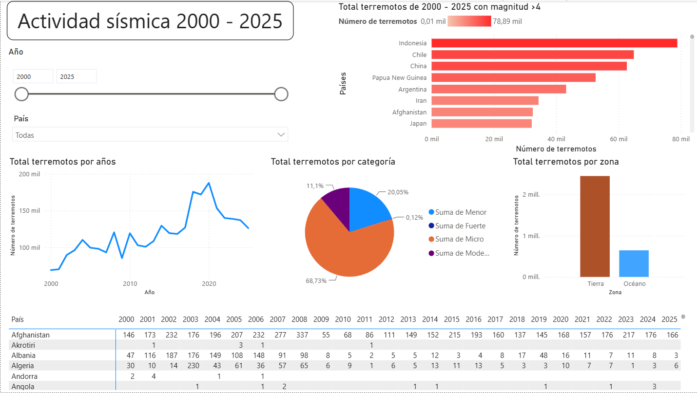
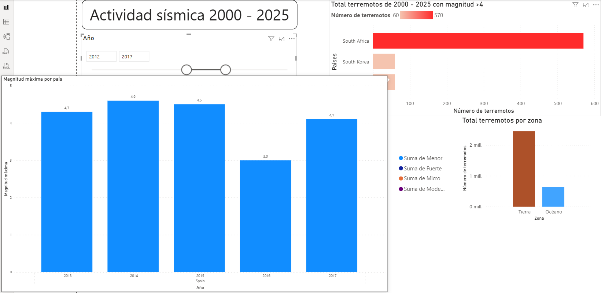
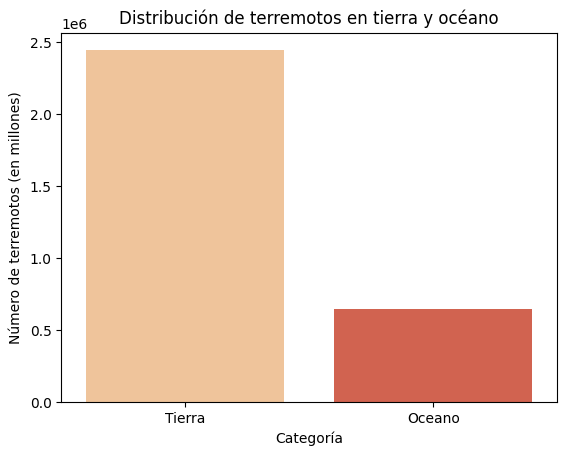
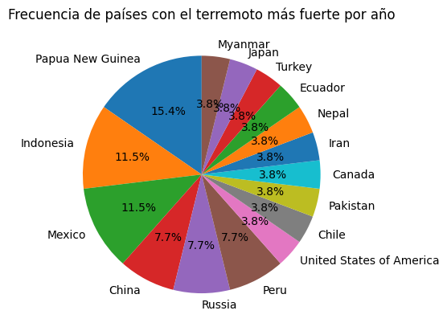
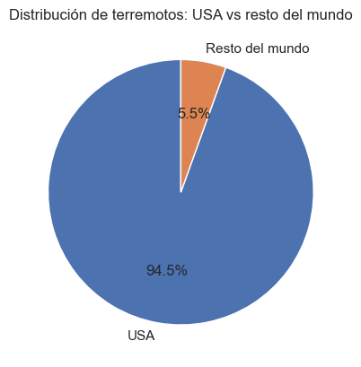
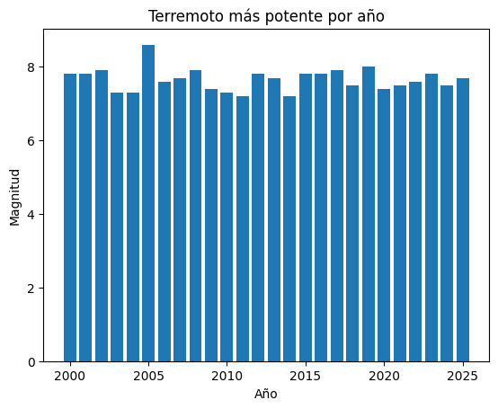
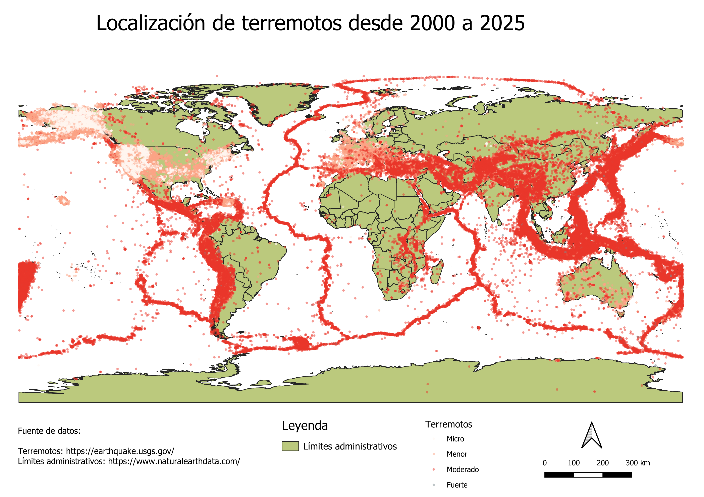

# Earthquakes-analysis

Análisis de la actividad sísmica global entre 2000 y 2025 utilizando datos de la API de USGS.

El objetivo del proyecto es estudiar la frecuencia, distribución geográfica y evolución de los terremotos.

## Descripción del proyecto

En el proyecto se construye un pipeline completo de datos (ETL) para analizar la actividad sísmica global:

- Extracción de datos desde la API oficial de USGS
- Transformación y limpieza de datos
- Enriquecimiento geoespacial con GeoPandas
- Almacenamiento en SQLite
- Análisis y visualización en Python y Power BI

El dataset final contiene más de 3 millones de registros oficiales, incluyendo los terremotos de magnitud inferior a 2 (normalmente excluidos en estudios).

Para el dashboard en Power BI se ha optado por trabajar con un dataset resumen en lugar de la base completa, optimizando el rendimiento y aplicando las buenas prácticas habituales de BI.

Se utiliza SQLite al no necesitar instalar nada. Genera un archivo local .db, perfecto para proyectos como éste y mejora su portabilidad.

Se incluye un pipeline completo para la explotación de datos en archivos CSV.

## Tecnologías utilizadas

- QGIS 3.40
- Power BI
- Python 3.13
- Librerías estándar:

    - pathlib: manejo de carpetas y archivos
    - pandas: manipulación de datos
    - geopandas: análisis geoespacial
    - sqlite3: almacenamiento
    - seaborn: visualización de datos
    - matplotlib: visualización de datos
    - time: soporte ETL
    - calendar: soporte ETL
    - json: soporte ETL
    - requests: consumo de API
    
## Pipeline de datos (ETL)

1. Extracción:
    - Descarga de datos desde la API de USGS
    - División de consultas por meses/semanas para evitar límites de API

2. Transformación:
    - Conversión de fechas
    - Creación de nuevas variables
    - Extracción y normalización del nombre de países
    - Enriquecimiento geoespacial con GeoPandas

3. Carga:
    - Carga de datos en SQLite
    - Control de errores y recuperación de datos fallidos en consulta de API
    - Dataset final completo

## Problemas encontrados

- Límite de registros por consulta API (20.000)

Solución implementada: 
    - División de consultas por rangos semanales (main_failed_range_API.py)
    - Implementación de validaciones
    - Preproceso de rangos fallidos

## Estructura

earthquakes-analysis/

- database/
    - geoespatial/ # Limites administrativos
    - processed/ # Base de datos final
    - raw/ # Muestra de datos sin procesar CSV
    - raw_api/ # Datos sin procesar API

- images/ # Gráficos generados

- notebooks/ # Análisis exploratorio

- power bi/ # Dashboard y tablas utilizadas

- sql/ # Schema y queries utilizadas

- src/ # Lógica ETL

- main_API.py # Pipeline principal API
- main_CSV.py # Pipeline con datos CSV
- main_failer_range_API.py # Pipeline secundario API
- dashboard.pbix
- README.md

## Preguntas a responder

- Número de terremotos por país.
- Países con mayor actividad sísmica.
- Top 10 terremotos.
- Evolución temporal de terremotos.
- Relación magnitud vs profundidad.
- Distribución geográfica (mapa).
- Frecuencia de terremotos > 6 por año.

## Análisis realizado

### 1. Distribución por magnitud

- +70% de los terremotos son de magnitud <2
- Confirmación de una actividad sísmica activa pero de baja intensidad

### 2. Evolución temporal

- Incremento de los registros desde 2000 a 2020, pero no asegura que sea por un aumento de la actividad sísmica, sino por una mejora en los sistemas de detección.

### 3. Distribución geográfica

- Mayor actividad sísmica en el Anillo de Fuego del Pacífico, seguido del Cinturón Transasiático.
- Fuerte actividad en zonas oceánicas 

### 4. Sesgo de datos

- USA domina debido a la mejor red de sensores y a la cantidad de sísmos con magnitud <2
- En sísmos de magnitud >4 elimina esta dominancia

### 5. Eventos de alta magnitud

- Concentración de países sísmicamente activos:
    - Indonesia
    - Chile
    - Papua Nueva Guinea
    - Argentina
    - Iran
    - Afganistan
    - Japón
    - Perú
    - México

### 6. Dashboard

#### Captura principal del Dashboard

#### Captura ejemplo del Dashboard filtrado por período (2012-2017) y países (South Africa, South Korea, Spain)

## Ejemplos visuales

### Distribución

### Alta magnitud

### Categorías

### USA vs Resto

### Máxima magnitud por año

### Mapa distribución

## Conclusiones

- Actividad sísmica global constante y de baja intensidad principalmente (70% inferior a magnitud 2).
- El aumento de registros está influenciado por mejoras tecnológicas y distribución de puntos de control.
- La distribución geográfica de los sísmos confirma los límites de placas tectónicas.
- Los países con mayor número de registros no coincide necesariamente con los terremotos más intensos.

## Valor del proyecto

El proyecto demuestra:

- Desarrollo de pipelines ETL completos.
- Consumo de APIs reales con restricciones.
- Tratamiento de grandes volúmenes de datos (>3M registros).
- Análisis geoespacial con GeoPandas.
- Visualización y comunicación

## Posibles mejoras

- Automatización del pipeline y análisis en tiempo real.
- Modelos predictivos.

## Sobre los datos

Debido al tamaño del dataset, no está incluido en el repositorio.
Para reproducir los resultados, ejecutar "main_API.py".
